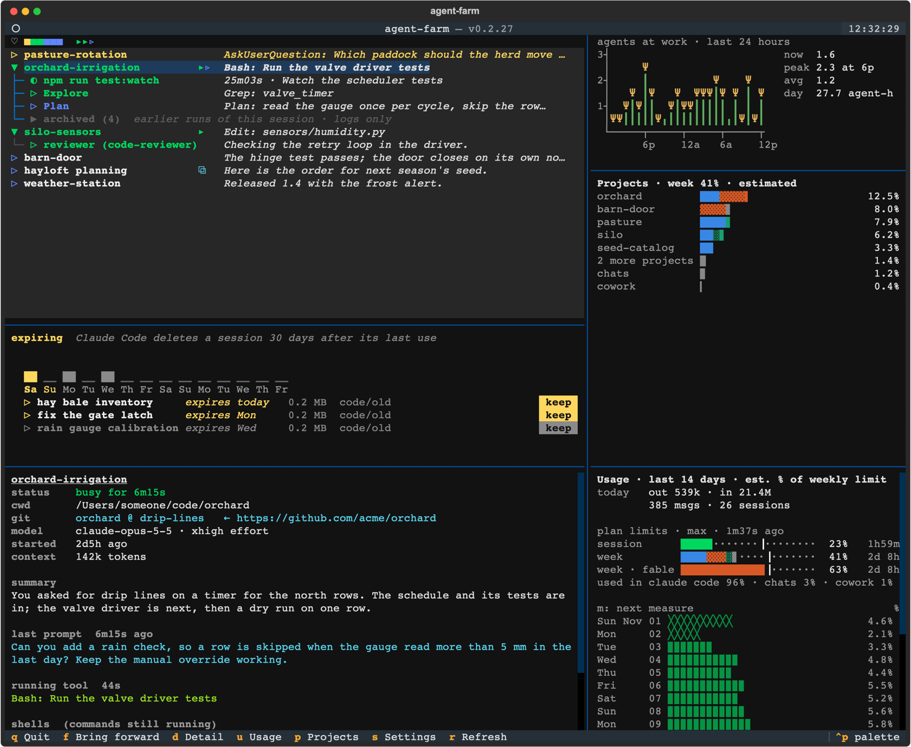

# 🌾 agent-farm

**Run a dozen Claude Code agents without dealing with a dozen tabs.**

Aaah!  One agent has been waiting twenty minutes for a one-word answer. Another finished an hour
ago. Something used a third of your weeks limit and you can't say what. agent-farm is a Mac app that
puts your whole fleet in one window, with whatever needs you at the top, so your agents keep
moving and you step in when needed.  Engineered for Claude Code and iTerm2.

**[Download for Mac](https://github.com/djp3/agent-farm/releases/latest)** · macOS 13+ on
Apple silicon · free and open source

### The agent that needs you is always on top

Every session in iTerm2 and the Claude desktop app lands on one list, with whoever has waited
longest first. Pick one, press `f`, and you're in its tab (this is surprisingly great). Even the title bar pitches in: one
🐓 per session that's busy or waiting, so the Dock and the window switcher show how the farm
is doing before you open it.

### The whole team at a glance

Subagents and teammates nest under their lead, with the commands they have running beneath
whoever started them. Green is at work, blue is at rest, gray has stopped, and a white name
means you can step in. You can spot a stuck subagent without opening a single transcript.

### See where your week went

Turn on plan limits and you get what `/usage` shows, then more: the `week` bar splits by
model, `p` breaks the week's percent down repo by repo (chats and Cowork get their own rows),
and the daily bars estimate how much of your limit each day took. A tick on each limit bar
marks an even pace, so you know you're running hot while there's still time to slow down.

### Never lose a session to the 30-day cleanup

Claude Code quietly deletes sessions 30 days after their last use. agent-farm lists the ones
going next, and one click (or `k`) gives any of them another 30 days before purging their context.

### Installs nothing. Stays on your Mac.

No hooks, no plugins, no changes to your Claude Code setup. agent-farm reads the files Claude
Code already writes, checks the process list, and listens to iTerm2 over one quiet connection,
with a ♥ that beats each time it checks in. It sends none of your work anywhere: its only
network traffic is a daily update check with GitHub and, if you turn plan limits on, the same
usage request `/usage` makes. Apart from its own settings and log, the only thing it ever
changes is a session's file modification times, when you press keep.

## Install

1. Download `agent-farm-<version>.zip` from the
   [latest release](https://github.com/djp3/agent-farm/releases/latest), unzip it and drag
   `agent-farm.app` to Applications.
2. Open it. The app is notarized, so it opens like any other download.

Updates take care of themselves: the app checks GitHub once a day and offers each new release
with its notes. **agent-farm ▸ Check for Updates…** checks now.

You need macOS 13 or later on Apple silicon, and Claude Code. To reach iTerm2 tabs, turn on
iTerm2's Python API (iTerm2 ▸ Settings ▸ General ▸ Magic ▸ Enable Python API).

You may be asked for a few permissions along the way, all optional:

- **Files and Folders** (Documents, Desktop and similar) lets agent-farm find the git
  repository of sessions working in those folders.
- **iTerm2 access**, the first time agent-farm connects to it, lets `f` bring a tab forward.
- **Keychain access**, only if you turn on plan limits. See [The usage panel](#the-usage-panel).

## The window

Under the title bar, two columns. On the left, from top to bottom:

- **The fleet line**: the whole fleet at a glance, one glyph per session, plus anything
  that needs attention. Hover it for a plain-text explanation of every glyph and count.
- **The tree**: one row per head session, ordered so that what needs you is at the top,
  with subagents nested beneath their lead and the shells each agent is running beneath it.
- **The detail pane**: everything known about the selected row.
- **The expiring pane**: the sessions Claude Code will delete next, each with a keep button.

On the right, **the usage panel**, down the full height of the window: your token usage per
day and per model (press `u`), how the week's limit was spent across your projects (press
`p`), and at the bottom how many agents were at work in each of the last 24 hours, as tall as
the expiring pane beside it. With both graphs hidden the panel closes and the left column
takes the whole width.

The title bar reads 🌾 agent-farm, then one 🐓 per session that is busy or waiting, so the
Dock, Mission Control and the window switcher show whether the farm needs you.

### Keys

| key | action |
|-----|--------|
| ↑ ↓ | move |
| enter / space | fold or unfold the row's subagents and shells |
| tab | move between the tree and the expiring pane |
| k | in the expiring pane: keep the selected session another 30 days |
| f | bring that session forward: its iTerm2 tab, or the Claude desktop app |
| d | show / hide the detail pane (it hides itself when the window is short) |
| u | show / hide the usage graph |
| p | show / hide the project graph (with both graphs hidden the right column closes) |
| m | cycle the usage measure: estimated limit use, output tokens, input tokens incl. cache, API messages |
| s | settings (esc returns) |
| r | refresh now |
| q | quit |

A click on a row selects it and leaves it folded or unfolded as it was; only a click on its
triangle folds or unfolds it. That works from another app too: the click that brings
agent-farm forward also lands on the row.

The View menu changes the text size (⌘+ / ⌘-), picks any fixed-pitch font installed on
the Mac, and toggles font smoothing; the window remembers all of that with its size and
place. On a non-Retina display a larger size or a font such as Menlo reads steadier.

### Reading a row

Every row starts with exactly one icon. Agents (sessions and subagents)
get triangles, shells a circle:

| icon | meaning |
|------|---------|
| ▶ / ▼ | an agent with rows beneath it: subagents, shells or an archive (folded / unfolded) |
| ▷ | an agent with nothing beneath it |
| ◐ | a shell: a command an agent started, still running |

The colors follow one rule. The icon says what the row is doing. The name is **white for
a session you can talk to**, waiting for your input or idle, and otherwise takes the
state's color. The summary after it is colored only when it needs you or is over:

| state | icon | name | summary |
|-------|------|------|---------|
| session **waiting** for your input (permission prompt, question, plan approval) | yellow | white | yellow |
| session **busy**; subagent **running** or **starting**; shell **running** | green | green | default |
| session **idle**, or idle while a command it started runs | blue | white | default |
| subagent **dormant** (finished, can be messaged again), or waiting on its own command | blue | blue | default |
| subagent **stale** (stopped mid-task); a shell whose agent is stale | gray | gray | gray |
| session **inactive**: a registry entry left behind, or an unregistered process | gray | gray | gray |
| subagent **archived** (from an earlier run, log only), and the archive row | dark gray | dark gray | dark gray |
| session agent-farm could not read (see the log) | red | red | red |

So green is at work, blue at rest, gray stopped, and white names are where you can step in.
The selected row keeps its colors on a navy bar.

After the name comes the **agent strip** column: a cyan `⧉` first when the session runs
inside the Claude desktop app, then one small triangle per subagent of the current run and
one `✱` per five, in the icon colors and ordered running → starting → waiting on a
command → dormant → stale. `▸` is at work and `▹` is not, so the strip reads without
color. The strip column is as wide as the widest team on screen, and names are padded to
a fixed column, so activity text lines up down the whole list.

Last comes the activity text: what a waiting session is waiting for, the running tool, or
the last message; a subagent with nothing to say yet shows its task. A shell's row shows
the command where a name goes, then how long it has run and what it is for, in the agent's
own words (`◐ npm test  2m03s · Run the test suite`). A command gets a row once it has run
five seconds, so a busy agent's quick commands never flicker in and out, and it is nested
under the agent that started it: the session itself, or one of its subagents.

### The fleet line

From left to right:

- **A heart for the connection to iTerm2.** A green `♥` while connected, which beats (flashes
  bright) each time agent-farm reads iTerm2's tabs: when iTerm2 announces a tab opening,
  closing or moving, and once a minute besides. A gray `♡` while iTerm2 is not running or
  agent-farm is connecting. A red `♡` when iTerm2 keeps turning the connection down, most
  often because its Python API is off. Hover for the details.
- **One `■` per head session**, grouped and colored waiting → busy → idle → inactive (yellow,
  green, blue, gray), so the count of each color is the count of sessions in that state.
- **The fleet-wide subagent tally**, in triangles and asterisks.
- **Two red notes, only when something is wrong**: `it2 missing` when agent-farm has no way
  to reach iTerm2 at all (the `f` key needs it), and `⚠ N` for warnings logged in the last
  ten minutes.

### The detail pane

For a head session: its state and how long it has been in it ("idle for 45s"), the working
directory, the git repository and branch (with "worktree of …" for linked worktrees,
including the ones `claude --worktree` makes), model and effort, start time, context size
and logged cost, the session summary, your last prompt, the running tool, the shells still
running (quick ones too: how long each has run, what it is for and the command itself),
anything queued, and the last message. Desktop-app sessions add a `where` line. For a
subagent: its state, its task, a teammate's own color (the one Claude Code shows its name
in), its shells and its last message. For a shell: whether it is running or stale, how
long, what it is for, the agent that started it, and the whole command. While the expiring
pane has focus, the detail pane shows its selected session instead: when it was last used
and when it expires, its folder, its size, and the command that resumes it.

### The expiring pane

Claude Code deletes a session 30 days after its last use: its transcript, subagents and
tool results go at the first cleanup after that, and a cleanup runs a few minutes after any
Claude Code session starts. (The period is `cleanupPeriodDays` in `~/.claude/settings.json`;
0 means never, and the pane says so.) The pane at the bottom of the left column lists the
sessions that turn that old within two weeks, soonest first.

At the top a chart counts them per day for the next two weeks, today at the left. Below it
each session has its name (the one `/resume` shows), when it expires (turns 30 days old;
it is deleted at the first cleanup after that, and until then keep still saves it, so an
expired session can be kept too), its size with its subagents and tool results, its folder,
and a **keep** button. Two days or less to go is yellow, with a white name: it needs you.
The rest are gray. Sessions you started in the Claude desktop app are not listed; Claude
Code never deletes those by age.

**keep** gives a session another full 30 days. A click on the button does it, or tab to the
pane, pick a session with ↑ ↓ and press `k`. agent-farm sets the modification time of
everything Claude Code judges the session by to now: the transcript and the files beside
it, the tool results, and the session's checkpoints, environment and task list. Nothing is
written into any file, and resuming a session keeps it too. A kept session shows green for
a minute, with the date it is safe until, and then leaves the list.

The pane is as tall as the agents-at-work chart beside it and scrolls when the sessions do
not all fit. It hides itself in a short window, and the **Expiring pane** setting turns it
off, leaving the left column to the tree and the detail pane.

### Ordering

The default ordering, **attention**, puts first what needs you:

1. **waiting** for your response, longest wait first
2. **busy** on your input, most recent prompt first
3. **idle while a command it started runs**, most recent prompt first
4. **idle**, most recently gone idle first
5. **inactive**

The alternatives, chosen in Settings, are **activity** (most recent transcript event first),
**started** (launch order) and **name**. The cursor stays on the same session when rows move.

### Settings

`s` opens the settings panel; esc returns. Changes apply at once and persist.

- **Show status text in rows** (off): puts the state word and its age into every row, for
  readers who cannot rely on the glyph color.
- **Usage graph open at launch** (off).
- **Project graph open at launch** (off).
- **Align activity text** (on): pad names to a fixed column so the activity text lines up.
- **Plan limits in the usage panel** (off): the `/usage` windows, fetched with your Claude
  Code sign-in. See the usage panel section for what that involves.
- **Expiring pane** (on): the sessions Claude Code deletes next, with their keep buttons.
- **Ordering**: attention, activity, started or name.

**Monitor ▸ Reveal Settings File** shows the JSON file behind the panel; the name column
width lives only there.

### The usage panel

**The daily bars.** One bar per local day for the last 14 days, labelled by weekday,
aggregated from every transcript under `~/.claude/projects`, subagents included. The measure
is named in the title and over the value column; `m` cycles it. Today's bar is drawn at full
green and the rest dimmed.

The 14 days span three limit weeks, and a bar's fill says which:

| fill | days |
|------|------|
| solid `█` | this week: the days the `week` bar counts |
| dense shade `▓` | last week |
| cross-hatch `╳` | the week before |

The first measure, estimated limit use, gives each day's tokens the weights the project graph
uses and shows them as a percent of your weekly limit, so the days since the week began add
up to Claude Code's part of the `week` bar (chats and Cowork are the rest). No raw count does
that: cache reads are almost all the tokens but are cheap, and output is under one percent of
the tokens but a sixth of the weight. With plan limits off it shows each day's share of the
14 days instead.

Beneath the days a stacked bar splits output tokens by model, with a legend; each model keeps
its color and texture for the life of the app, so the stack reads without color. The "logged
cost" line sums the cost checkpoints Claude Code writes at the end of each session, so
today's sessions are not in it yet.

**Plan limits.** With the setting on, a block above the days shows what `/usage` shows in
Claude Code: one bar per rate-limit window your plan has (the current week, per-model weeks
such as Fable, a 5-hour session on plans that have one, and extra spend when it is on) with
the percent used and the time left until it resets. When a window has reset since the last
reading, it says `reset` until the next fetch.

- **Color.** Anthropic's reading of a window sets its color when the reply gives one;
  otherwise green turns orange at 75% and red at 90%.
- **Pace.** A tick in each bar marks how far through its window the clock is, which is where
  an even pace would put you: a bar that stops short of the tick is using less than that, one
  that runs past it more. Extra spend has no such clock and no tick.
- **Models.** The `week` bar is split by model in the colors and textures of the
  output-by-model bar below, estimated the way the project graph is, with chats and Cowork in
  gray at its end. A model's week, such as Fable's, is drawn in that model's color. Either
  turns orange or red as a whole when it needs attention.
- **Surfaces.** The last line says where the week's use went by surface (`used in claude code
  90% · chats 6% · cowork 4%`); those are shares of what you used, not of a limit.

Those numbers exist nowhere on disk, so agent-farm fetches them the way Claude Code does: it
reads the Claude Code sign-in from your Keychain (the item named `Claude Code-credentials`)
and asks Anthropic's usage endpoint when you open the panel, then again as soon as a session
or subagent has worked since the last fetch, at most once every five minutes. While everyone
is idle or waiting for you no request goes out and the header says paused, since the numbers
cannot move. macOS may ask you to allow the Keychain read.

The sign-in is used as is, never renewed, never written anywhere and never logged; when it
has expired, the block says so until Claude Code renews it. The plan's name in the header
comes from the profile Claude Code keeps in `~/.claude.json`, the only value taken from that
file. The block is off by default, and while it is off it makes no network request.

**Projects.** Press `p` for how the week's percent was spent, on its own or below the usage
graph: one row per GitHub repo, largest first, with the five largest named. The rows add up
to the `week` bar, so with the week at 40% a project at 30% used most of it. Chats and Cowork
have no folder, so each gets a row of its own. A worktree counts toward its repo and two
clones of a repo count as one. A folder outside any repo counts toward the folder its session
started in. Each message counts toward the folder it ran in, so agents working in the same
repo add up, and an agent that moves between repos is split between them. Bars take the
model colors from the output-by-model bar. To name a repo agent-farm reads the origin remote
from its `.git/config` and keeps only the owner and repo.

The split is an estimate. Anthropic reports the week's total and its shares by surface but
not by project, so agent-farm divides Claude Code's share by what each message's tokens are
worth relative to the others, using the list rates of its model. No money is shown. With
plan limits off, or for a moment after the week resets, the rows are percents of the last 7
days' use instead.

**Agents at work.** Pinned to the bottom of the panel, one wheat stalk per clock hour for
the last 24 hours, the current hour at the right. A stalk's height is how many agents
(sessions and subagents together) were running in that hour on average: three agents that
each ran for half an hour make 1.5. An hour with a little work that rounds to nothing still
shows a sprout. Beside it: agents running this hour so far, the busiest hour, the average
across all 24 hours, and the day's total in agent-hours. Running time comes from the
transcripts: an agent counts as running from each message or tool result until its turn
ends or you interrupt it, and a silence counts for at most ten minutes, so a permission
prompt left open overnight does not read as a night of work. An agent waiting on a
background command counts as running until Claude Code reports the command finished; one
still going counts up to now while its shell is running.

## What the states mean

- **busy** and **idle** come straight from Claude Code's own session registry.
- **waiting** is inferred from the transcript: a permission request without a result yet,
  or an open question or plan approval.
- **Shells** come from the process list. Claude Code runs every command in a shell of its
  own under the session's process, and the transcript says which agent issued the command
  and what it is for. An idle session or a dormant subagent with one of its shells still
  running is waiting on it: a background command, a monitor, or a command moved to the
  background. A shell is **stale** when the subagent that started it stopped mid-task, so
  nothing will read its result.
- Subagents are **running** while their transcript changed in the last 90 s, or ends mid
  tool-call and is under 15 min old; **dormant** once the head agent received their final
  message (they stay resident and can be messaged again); **stale** when they end mid
  tool-call and have been silent over 15 min, and **archived** once that silence passes a
  day; **archived** too when their last activity predates the current head process.
- A head session's row unfolds on its own when a subagent has a material update: a new
  agent, a state change, or a new message. Plain tool calls do not count, so a row you
  folded stays folded until something worth seeing happens.
- Archived subagents sit under a collapsed **archived (N)** row at the bottom of their
  head session's team. Agents from an earlier run of a resumed session are transcripts
  only and cannot be woken, so agent-farm never unfolds that row by itself.

## Files and logs

| what | where |
|------|-------|
| settings | `~/Library/Application Support/agent-farm/settings.json` |
| log | `~/Library/Logs/agent-farm/agent-farm.log` |

Errors never appear in detail on screen; the fleet line only shows the `⚠ N` badge.
**Monitor ▸ Open Log Folder** opens the log, which records failed focus attempts and why,
unreadable registry files, malformed transcript rows and any crash. If the monitor inside
the window ever stops, the window says so and **Monitor ▸ Restart Monitor** (⌘R) starts
it again.

## How it works

Claude Code keeps a registry entry per running session in `~/.claude/sessions`, with its
busy or idle state, and appends every turn to a transcript under `~/.claude/projects`;
subagents get transcripts of their own next to their lead's. agent-farm tails those files
once a second, checks their modification times once a minute for the expiring pane, looks at
which shells each session's process is running, and draws the result.

Which tab owns which terminal comes from iTerm2's Python API over one connection, made while
iTerm2 is running (agent-farm never starts it): iTerm2 hands out one pass for it, through
AppleScript, and then announces every tab that opens, closes or moves. agent-farm re-reads
the tabs then and once a minute, and brings a tab forward over the same connection.

The app is a Python program (Textual) running inside a native window; see
[DEVELOPMENT.md](DEVELOPMENT.md) to run it from source, build the app or cut a release.

## License

GPL-3.0-or-later. See [LICENSE](LICENSE).

The app icon's rooster is from [Noto Emoji](https://github.com/googlefonts/noto-emoji),
copyright Google LLC, used under its open license; see
[NOTICE-noto-emoji.txt](macos/Resources/NOTICE-noto-emoji.txt).
