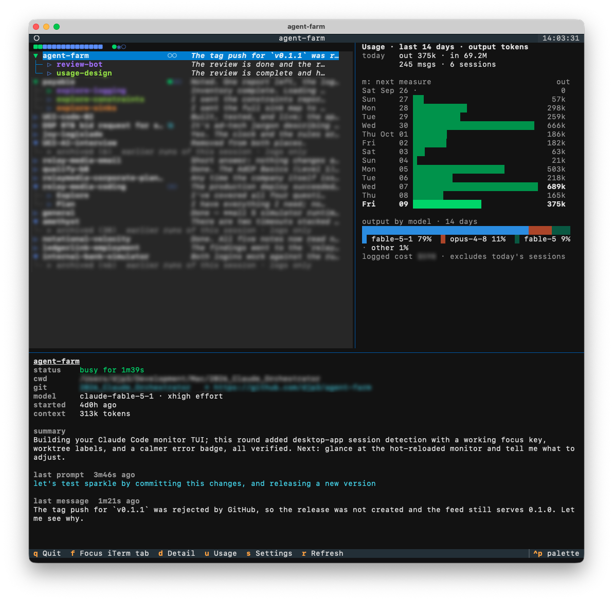

# agent-farm

A Mac app that shows every Claude Code session running on your machine in one window:
what each one is doing, whether it is busy, idle or waiting for you, and the subagents or
teammates working under it. Sessions in iTerm2 and in the Claude desktop app both appear.

It is strictly read-only. Nothing is installed into Claude Code and no hooks are added;
agent-farm only reads the files Claude Code already writes under `~/.claude` and asks
iTerm2 which tab owns which session. The one optional exception is the plan-limits block
of the usage panel, off by default, which asks Anthropic for the same numbers `/usage`
shows (see [The usage panel](#the-usage-panel)).

## Install

1. Download `agent-farm-<version>.zip` from the
   [latest release](https://github.com/djp3/agent-farm/releases/latest), unzip it and drag
   `agent-farm.app` to Applications.
2. Open it. The app is notarized, so it opens like any other download.
3. On first use macOS may ask for one permission, which is optional: **Files and Folders**
   (Documents, Desktop and similar) lets the detail pane show the git repository of
   sessions working in those folders.

Updates install themselves: the app checks GitHub once a day and offers each new release
with its notes. **agent-farm ▸ Check for Updates…** checks now.

Requires macOS 13 or later on Apple silicon, Claude Code, and iTerm2 if you want the
tab-focus key.

## The window

From top to bottom:

- **The title bar**: 🌾 agent-farm, then one 🐓 per session that is busy or waiting, so the
  Dock, Mission Control and the window switcher show whether the farm needs you.
- **The fleet line**: the whole fleet at a glance, one glyph per session, plus anything
  that needs attention. Hover it for a plain-text explanation of every glyph and count.
- **The tree**: one row per head session, ordered so that what needs you is at the top,
  with subagents nested beneath their lead.
- **The detail pane**: everything known about the selected row.
- **The usage panel** (hidden until you press `u`): your token usage per day and per model,
  and how many agents were at work in each of the last 24 hours.

### Keys

| key | action |
|-----|--------|
| ↑ ↓ | move |
| enter / space | fold or unfold a head session's team |
| f | bring that session forward: its iTerm2 tab, or the Claude desktop app |
| d | show / hide the detail pane (it hides itself when the window is short) |
| u | show / hide the usage panel |
| m | cycle the usage measure: output tokens, input tokens incl. cache, API messages |
| s | settings (esc returns) |
| r | refresh now |
| q | quit |

The View menu changes the text size (⌘+ / ⌘-), picks any fixed-pitch font installed on
the Mac, and toggles font smoothing; the window remembers all of that with its size and
place. On a non-Retina display a larger size or a font such as Menlo reads steadier.

### Reading a row

Every row starts with exactly one glyph, so names line up:

| glyph | meaning |
|-------|---------|
| ▶ / ▼ | the row has children to fold or unfold (collapsed / expanded) |
| ▷ | nothing beneath this row |

The glyph's color is the row's state. The four head-session colors are the ones iTerm2
paints on its own Claude status dot, so the tab bar and agent-farm agree:

| color | head session | subagent |
|-------|--------------|----------|
| orange | **waiting** for you (permission prompt, question, plan approval) | |
| green | **busy** on your input | **running**; dimmed while **starting** |
| blue | **idle**, ready for your next instruction | dimmed: **dormant**, finished but resident |
| grey | **inactive**: a stale registry entry or an unregistered process | dimmed: **archived**, log only |
| magenta | | **stale**: silent too long mid tool-call, likely killed |
| red | agent-farm could not read this session (see the log) | |

After the glyph comes the session name, then the **agent strip** column: a cyan `⧉` first
when the session runs inside the Claude desktop app, then one circle per subagent of the
current run and one `✱` per five, in the same colors and ordered running → starting →
stale → dormant.
`●` is working, `○` finished and dormant, `◌` still starting, `◍` stale, so the strip reads
without color. The strip column is as wide as the widest team on screen, and names are
padded to a fixed column, so activity text lines up down the whole list.

Last comes the activity text: what a waiting session is waiting for, the running tool, or
the last message; a subagent with nothing to say yet shows its task.

### The fleet line

One `■` per head session, grouped and colored waiting → busy → idle → inactive, so the
count of each color is the count of sessions in that state, then the fleet-wide subagent
tally in circles and asterisks. Two red notes appear only when something is wrong:
`it2 missing` when iTerm2's command-line tool cannot be found (the `f` key needs it), and
`⚠ N` for warnings logged in the last ten minutes.

### The detail pane

For a head session: its state and how long it has been in it ("idle for 45s"), the working
directory, the git repository and branch (with "worktree of …" for linked worktrees,
including the ones `claude --worktree` makes), model and effort, start time, context size
and logged cost, the session summary, your last prompt, the running tool, anything queued,
and the last message. Desktop-app sessions add a `where` line. For a subagent: its state,
its task and its last message.

### Ordering

The default ordering, **attention**, puts first what needs you:

1. **waiting** for your response, longest wait first
2. **busy** on your input, most recent prompt first
3. **idle**, most recently gone idle first
4. **inactive**

The alternatives, chosen in Settings, are **activity** (most recent transcript event first),
**started** (launch order) and **name**. The cursor stays on the same session when rows move.

### Settings

`s` opens the settings panel; esc returns. Changes apply at once and persist.

- **Show status text in rows** (off): puts the state word and its age into every row, for
  readers who cannot rely on the glyph color.
- **Usage panel open at launch** (off).
- **Align activity text** (on): pad names to a fixed column so the activity text lines up.
- **Plan limits in the usage panel** (off): the `/usage` windows, fetched with your Claude
  Code sign-in. See the usage panel section for what that involves.
- **Ordering**: attention, activity, started or name.

**Monitor ▸ Reveal Settings File** shows the JSON file behind the panel; the name column
width lives only there.

### The usage panel

One bar per local day for the last 14 days, labelled by weekday, aggregated from every
transcript under `~/.claude/projects`, subagents included. The measure is named in the
title and over the value column; `m` cycles it. Today's bar is drawn at full green and the
rest dimmed. Beneath the days a stacked bar splits output tokens by model, with a legend;
each model keeps its color and texture for the life of the app, so the stack reads without
color. The "logged cost" line sums the cost checkpoints Claude Code writes at the end of
each session, so today's sessions are not in it yet.

**Plan limits.** With the setting on, a block above the days shows what `/usage` shows in
Claude Code: one bar per rate-limit window (the current 5-hour session, the current week,
and per-model weeks such as Fable on plans that have them) with the percent used and the
time left until it resets. Green turns orange at 75% and red at 90%. A tick in each bar
marks how far through its window the clock is, which is where an even pace would put you:
a bar that stops short of the tick is using less than that, one that runs past it more.
When a window has reset since the last reading, it says `reset` until the next fetch.
Those numbers exist nowhere on disk, so
agent-farm fetches them the way Claude Code does: it reads the Claude Code sign-in from
your Keychain (the item named `Claude Code-credentials`) and asks Anthropic's usage
endpoint when you open the panel, then again as soon as a session or subagent has worked
since the last fetch, at most once every five minutes. While everyone is idle or waiting
for you no request goes out and the header says paused, since the numbers cannot move. macOS may ask you to allow the Keychain
read. The sign-in is used as is, never renewed, never written anywhere and never logged;
when it has expired, the block says so until Claude Code renews it. The block is off by
default and the app makes no network request of its own while it is off.

**Agents at work.** Pinned to the bottom of the panel, one wheat stalk per clock hour for
the last 24 hours, the current hour at the right. A stalk's height is how many agents
(sessions and subagents together) were running in that hour on average: three agents that
each ran for half an hour make 1.5. An hour with a little work that rounds to nothing still
shows a sprout. Beside it: agents running this hour so far, the busiest hour, and the day's
total in agent-hours. Running time comes from the transcripts: an agent counts as running
from each message or tool result until its turn ends or you interrupt it, and a silence
counts for at most ten minutes, so a permission prompt left open overnight does not read as
a night of work.

## What the states mean

- **busy** and **idle** come straight from Claude Code's own session registry.
- **waiting** is inferred from the transcript: a permission request without a result yet,
  or an open question or plan approval.
- Subagents are **running** while their transcript changed in the last 90 s, or ends mid
  tool-call and is under 15 min old; **dormant** once the head agent received their final
  message (they stay resident and can be messaged again); **stale** when they end mid
  tool-call and have been silent over 15 min; **archived** when their last activity
  predates the current head process.
- A head session's row unfolds on its own when a subagent has a material update: a new
  agent, a state change, or a new message. Plain tool calls do not count, so a row you
  folded stays folded until something worth seeing happens.
- Archived subagents sit under a collapsed **archived (N)** row at the bottom of their
  head session's team. Agents from an earlier run of a resumed session are transcripts
  only and cannot be woken, so agent-farm never unfolds that row by itself.

## Files and logs

| what | where |
|------|-------|
| settings | `~/Library/Application Support/agent-farm/settings.json` |
| log | `~/Library/Logs/agent-farm/agent-farm.log` |

Errors never appear in detail on screen; the fleet line only shows the `⚠ N` badge.
**Monitor ▸ Open Log Folder** opens the log, which records failed focus attempts and why,
unreadable registry files, malformed transcript rows and any crash. If the monitor inside
the window ever stops, the window says so and **Monitor ▸ Restart Monitor** (⌘R) starts
it again.

## How it works

Claude Code keeps a registry entry per running session in `~/.claude/sessions`, with its
busy or idle state, and appends every turn to a transcript under `~/.claude/projects`;
subagents get transcripts of their own next to their lead's. agent-farm tails those files
once a second, asks iTerm2's `it2` tool which tab owns which terminal, and draws the
result. The app is a Python program (Textual) running inside a native window; see
[DEVELOPMENT.md](DEVELOPMENT.md) to run it from source, build the app or cut a release.

## License

GPL-3.0-or-later. See [LICENSE](LICENSE).

The app icon's rooster is from [Noto Emoji](https://github.com/googlefonts/noto-emoji),
copyright Google LLC, used under its open license; see
[NOTICE-noto-emoji.txt](macos/Resources/NOTICE-noto-emoji.txt).
